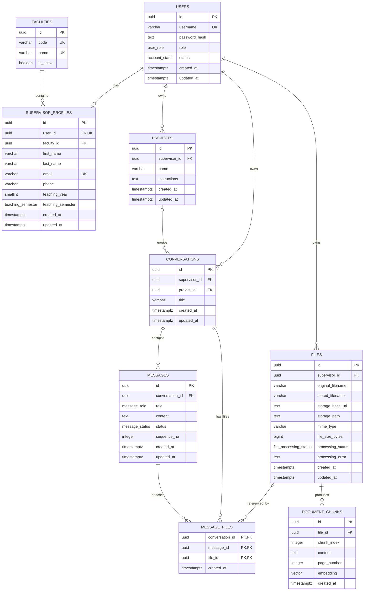

# Capstone Teaching Assistant — Revised Database Overview

The database uses:

* **PostgreSQL** for relational application data;
* **pgvector** for document embeddings used by RAG;
* **Object Storage** for original uploaded files.

The database contains the following core tables:

| Table                 | Purpose                                                                        |
| --------------------- | ------------------------------------------------------------------------------ |
| `users`               | Authentication, role and account status                                        |
| `faculties`           | Predefined Faculty reference data                                              |
| `supervisor_profiles` | Supervisor profile and teaching information                                    |
| `projects`            | Supervisor-owned Projects and Project-specific AI instructions                 |
| `conversations`       | Chat Conversations, optionally belonging to a Project                          |
| `messages`            | Supervisor and AI Assistant Messages                                           |
| `files`               | Uploaded File metadata and Object Storage location                             |
| `message_files`       | Associates Files with Conversations and, where applicable, individual Messages |
| `document_chunks`     | Parsed document chunks and pgvector embeddings                                 |

All core application tables include a nullable `deleted_at TIMESTAMPTZ` column reserved for future soft-delete support. A `NULL` value means the row is active.

---

# High-Level Model

```text
User
 |
 +-- Supervisor Profile
 |      |
 |      +-- Faculty
 |
 +-- Projects
 |      |
 |      +-- Conversations
 |
 +-- Conversations
 |      |
 |      +-- Messages
 |      |
 |      +-- Files
 |
 +-- Files
        |
        +-- Object Storage location
        |
        +-- Document Chunks
                |
                +-- pgvector embedding
```

The major change is:

```text
Project
   ↓
Conversation
   ↓
Message File
   ↓
File
```

instead of:

```text
Project
   ↓
File
```

---

# Full Revised ERD



# 1. `users`

Stores authentication and authorization information.

| Column          | Type             | Null | Description             |
| --------------- | ---------------- | ---: | ----------------------- |
| `id`            | UUID             |   No | Primary key             |
| `username`      | VARCHAR          |   No | Unique among active users |
| `password_hash` | TEXT             |   No | Secure password hash    |
| `role`          | `user_role`      |   No | `ADMIN` or `SUPERVISOR` |
| `status`        | `account_status` |   No | `ACTIVE` or `INACTIVE`  |
| `created_at`    | TIMESTAMPTZ      |   No | Creation timestamp      |
| `updated_at`    | TIMESTAMPTZ      |   No | Last update timestamp   |

Passwords must never be stored as plaintext.

---

# 2. `faculties`

Stores predefined Faculty reference information.

| Column      | Type    | Null | Description                   |
| ----------- | ------- | ---: | ----------------------------- |
| `id`        | UUID    |   No | Primary key                   |
| `code`      | VARCHAR |   No | Unique Faculty code           |
| `name`      | VARCHAR |   No | Unique Faculty name           |
| `is_active` | BOOLEAN |   No | Whether Faculty is selectable |

Faculty values are seeded/reference data.

---

# 3. `supervisor_profiles`

Stores Supervisor-specific profile information.

| Column              | Type                | Null | Description             |
| ------------------- | ------------------- | ---: | ----------------------- |
| `id`                | UUID                |   No | Primary key             |
| `user_id`           | UUID                |   No | FK → `users.id`, unique |
| `faculty_id`        | UUID                |   No | FK → `faculties.id`     |
| `first_name`        | VARCHAR             |   No | First name              |
| `last_name`         | VARCHAR             |   No | Last name               |
| `email`             | VARCHAR             |   No | Email address, unique among active profiles |
| `phone`             | VARCHAR             |  Yes | Phone number            |
| `teaching_year`     | SMALLINT            |  Yes | Teaching year           |
| `teaching_semester` | `teaching_semester` |  Yes | Teaching semester       |
| `created_at`        | TIMESTAMPTZ         |   No | Creation timestamp      |
| `updated_at`        | TIMESTAMPTZ         |   No | Last update timestamp   |

---

# 4. `projects`

Stores Supervisor Projects.

| Column          | Type        | Null | Description                      |
| --------------- | ----------- | ---: | -------------------------------- |
| `id`            | UUID        |   No | Primary key                      |
| `supervisor_id` | UUID        |   No | FK → `users.id`                  |
| `name`          | VARCHAR     |   No | Project name                     |
| `instructions`  | TEXT        |  Yes | Project-specific AI instructions |
| `created_at`    | TIMESTAMPTZ |   No | Creation timestamp               |
| `updated_at`    | TIMESTAMPTZ |   No | Last update timestamp            |

A Project belongs to exactly one Supervisor.

Files no longer reference Projects directly.

---

# 5. `conversations`

Stores Supervisor chat sessions.

| Column          | Type        | Null | Description             |
| --------------- | ----------- | ---: | ----------------------- |
| `id`            | UUID        |   No | Primary key             |
| `supervisor_id` | UUID        |   No | FK → `users.id`         |
| `project_id`    | UUID        |  Yes | FK → `projects.id`      |
| `title`         | VARCHAR     |   No | Conversation title      |
| `created_at`    | TIMESTAMPTZ |   No | Creation timestamp      |
| `updated_at`    | TIMESTAMPTZ |   No | Last activity timestamp |

When:

```text
project_id = NULL
```

the Conversation is unprojected.

Therefore Project membership is now determined entirely through the Conversation.

---

# 6. `messages`

Stores individual chat Messages.

| Column            | Type             | Null | Description              |
| ----------------- | ---------------- | ---: | ------------------------ |
| `id`              | UUID             |   No | Primary key              |
| `conversation_id` | UUID             |   No | FK → `conversations.id`  |
| `role`            | `message_role`   |   No | `USER` or `ASSISTANT`    |
| `content`         | TEXT             |   No | Message body             |
| `status`          | `message_status` |   No | Message generation state |
| `sequence_no`     | INTEGER          |   No | Position in Conversation |
| `embedding`       | VECTOR(1024)     |  Yes | pgvector embedding for semantic message search |
| `created_at`      | TIMESTAMPTZ      |   No | Creation timestamp       |
| `updated_at`      | TIMESTAMPTZ      |   No | Last update timestamp    |

Recommended constraint:

```text
UNIQUE(conversation_id, sequence_no)
```

`embedding` is nullable because a Message can be created before model processing starts or can fail during generation.

---

# 7. `files`

Files no longer contain `project_id`.

A File belongs directly only to a Supervisor.

| Column              | Type                     | Null | Description                             |
| ------------------- | ------------------------ | ---: | --------------------------------------- |
| `id`                | UUID                     |   No | Primary key                             |
| `supervisor_id`     | UUID                     |   No | FK → `users.id`; File owner             |
| `original_filename` | VARCHAR                  |   No | Original filename displayed in UI       |
| `stored_filename`   | VARCHAR                  |   No | Internal Object Storage filename        |
| `storage_base_url`  | TEXT                     |   No | Object Storage base URL plus any prefix |
| `storage_path`      | TEXT                     |   No | Path/object key to the original File    |
| `mime_type`         | VARCHAR                  |   No | MIME type                               |
| `file_size_bytes`   | BIGINT                   |   No | File size in bytes                      |
| `processing_status` | `file_processing_status` |   No | Document-processing state               |
| `processing_error`  | TEXT                     |  Yes | Processing error if applicable          |
| `created_at`        | TIMESTAMPTZ              |   No | Upload timestamp                        |
| `updated_at`        | TIMESTAMPTZ              |   No | Last update timestamp                   |

The original Object Storage location is:

```text
storage_base_url + storage_path
```

Example:

```text
storage_base_url
https://storage.example.com/capstone/

storage_path
supervisors/abc123/files/def456/handbook.pdf
```

Combined:

```text
https://storage.example.com/capstone/supervisors/abc123/files/def456/handbook.pdf
```

---

# 8. Revised `message_files`

This table now connects three concepts:

```text
Conversation
+
Message
+
File
```

| Column            | Type        | Null | Description             |
| ----------------- | ----------- | ---: | ----------------------- |
| `conversation_id` | UUID        |   No | FK → `conversations.id` |
| `message_id`      | UUID        |   No | FK → `messages.id`      |
| `file_id`         | UUID        |   No | FK → `files.id`         |
| `created_at`      | TIMESTAMPTZ |   No | Association timestamp   |

Recommended composite primary key:

```text
(message_id, file_id)
```

Although `conversation_id` is included, it does not necessarily need to be part of the primary key because `message_id` already identifies the Conversation indirectly.

A more practical SQL design is therefore:

```text
PRIMARY KEY (message_id, file_id)
```

with:

```text
conversation_id
```

stored explicitly for easier Conversation Library querying.

---

# 9. Why Add `conversation_id` to `message_files`

Previously:

```text
Conversation
    ↓
Messages
    ↓
message_files
    ↓
Files
```

was required to determine the Conversation Library.

With `conversation_id` stored directly:

```text
Conversation
    ↓
message_files
    ↓
Files
```

the query becomes simpler.

Example:

```sql
SELECT DISTINCT f.*
FROM files f
JOIN message_files mf
    ON mf.file_id = f.id
WHERE mf.conversation_id = :conversation_id
  AND f.supervisor_id = :current_supervisor_id;
```

This makes the Conversation-to-File relationship explicit.

---

# 10. Important Consistency Constraint

Because `message_files` stores both:

```text
conversation_id
message_id
```

the application must guarantee that:

```text
message.conversation_id
=
message_files.conversation_id
```

For example, this must never be allowed:

```text
message_id = MSG-101
MSG-101 belongs to Conversation A

message_files.conversation_id = Conversation B
```

That would create inconsistent data.

The backend should validate this every time a `message_files` record is created.

---

# 11. `document_chunks`

Stores document content processed for RAG.

| Column        | Type        | Null | Description                        |
| ------------- | ----------- | ---: | ---------------------------------- |
| `id`          | UUID        |   No | Primary key                        |
| `file_id`     | UUID        |   No | FK → `files.id`                    |
| `chunk_index` | INTEGER     |   No | Chunk position                     |
| `content`     | TEXT        |   No | Extracted chunk text               |
| `page_number` | INTEGER     |  Yes | Source page number where available |
| `embedding`   | VECTOR(1024) |   No | pgvector embedding                 |
| `created_at`  | TIMESTAMPTZ |   No | Creation timestamp                 |

Recommended constraint:

```text
UNIQUE(file_id, chunk_index)
```

The vector dimension is fixed to the local MVP embedding model configuration:

```sql
embedding VECTOR(1024)
```

---

# 12. Removed `message_sources`

The following table is removed completely:

```text
message_sources
```

Previously it represented:

```text
Assistant Message
    ↓
Retrieved Document Chunk
```

After its removal, the database does **not persist the exact chunk-level evidence used for each Assistant answer**.

The RAG process can still operate normally:

```text
Question
   ↓
Embedding
   ↓
Vector Search
   ↓
Relevant Chunks
   ↓
LLM
   ↓
Assistant Response
```

but the retrieved chunks are transient unless captured somewhere else.

---

# 13. Consequence of Removing `message_sources`

Previously:

```text
Assistant Message
      |
      +-- Chunk 7
      +-- Chunk 14
      +-- Chunk 21
```

was stored.

Now:

```text
Assistant Message

(no persistent source-chunk relationship)
```

Therefore the system cannot later reliably answer:

> Which exact chunks generated this historical answer?

You can still display the Files associated with the Conversation or question, but that means:

> "These Files were available to the AI"

rather than:

> "These exact Files/chunks were actually retrieved for this answer."

That distinction is important for your documentation.

---

# 14. Revised File Relationship Model

The File model is now:

```text
Supervisor
    |
    +---- File
           |
           +---- Document Chunks
           |
           +---- Message File
                    |
                    +---- Conversation
                    |
                    +---- Message
```

There is no longer:

```text
File → Project
```

direct relationship.

---

# 15. Project Library Logic

Since `files.project_id` no longer exists, a Project's Files must be derived through its Conversations.

Conceptually:

```text
Project
  ↓
Conversations
  ↓
message_files
  ↓
Files
```

Example query:

```sql
SELECT DISTINCT f.*
FROM files f
JOIN message_files mf
    ON mf.file_id = f.id
JOIN conversations c
    ON c.id = mf.conversation_id
WHERE c.project_id = :project_id
  AND c.supervisor_id = :current_supervisor_id;
```

Therefore:

> Project Library = unique Files associated with Conversations currently belonging to that Project.

---

# 16. Conversation Library Logic

Conversation Library is simpler:

```text
Conversation
   ↓
message_files
   ↓
Files
```

Example:

```sql
SELECT DISTINCT f.*
FROM files f
JOIN message_files mf
    ON mf.file_id = f.id
WHERE mf.conversation_id = :conversation_id
  AND f.supervisor_id = :current_supervisor_id;
```

---

# 17. Global Library Logic

Global Library remains straightforward:

```sql
SELECT *
FROM files
WHERE supervisor_id = :current_supervisor_id;
```

It shows every File owned by the Supervisor.

---

# 18. What "Uncategorised" Now Means

This changes significantly.

Previously:

```text
files.project_id = NULL
```

meant Uncategorised.

That field no longer exists.

Now a File is effectively **Uncategorised** when it is not associated with any Conversation that belongs to a Project.

Conceptually:

```text
File
  |
  +-- no message_files
```

or:

```text
File
  ↓
Conversation
  ↓
project_id = NULL
```

Such Files may be displayed under Uncategorised in the Global Library.

---

# 19. Important Edge Case: File Used in Multiple Projects

The new design permits the same File to appear in multiple Projects.

Example:

```text
File A
 |
 +-- Conversation 1
 |      |
 |      +-- Project Alpha
 |
 +-- Conversation 9
        |
        +-- Project Beta
```

Because the File itself no longer has a `project_id`, this is valid.

That can actually be useful because no duplicate upload is required.

However, it means a File no longer has exactly one Project classification.

It has **usage-based Project associations**.

---

# 20. Moving a Conversation

Suppose:

```text
Conversation C
    ↓
Project Alpha
```

contains:

```text
File A
File B
```

If the Conversation moves to Project Beta:

```text
Conversation C
    ↓
Project Beta
```

then the Files automatically appear in Project Beta's derived Library because the Project relationship comes from the Conversation.

No File records need to change.

This is simpler than the previous model.

---

# 21. Required Enums

## `user_role`

```text
ADMIN
SUPERVISOR
```

## `account_status`

```text
ACTIVE
INACTIVE
```

## `message_role`

```text
USER
ASSISTANT
```

## `message_status`

```text
PENDING
GENERATING
COMPLETED
FAILED
```

## `file_processing_status`

```text
UPLOADED
PROCESSING
READY
FAILED
```

## `teaching_semester`

```text
SEMESTER_1
SEMESTER_2
```

---

# 22. Revised RAG Data Flow

```text
Supervisor uploads File
        ↓
Object Storage
        ↓
FILES
        ↓
Extract text
        ↓
Chunk + overlap
        ↓
Generate embeddings
        ↓
DOCUMENT_CHUNKS
        ↓
pgvector similarity search
        ↓
Relevant chunks
        ↓
LLM
        ↓
ASSISTANT MESSAGE
```

Because `message_sources` has been removed:

```text
Relevant chunks
```

are not persisted as relationships after generation.

---

# 23. Ownership Model

Direct ownership exists on:

```text
projects.supervisor_id
conversations.supervisor_id
files.supervisor_id
```

Messages inherit ownership:

```text
Message
 ↓
Conversation
 ↓
Supervisor
```

Document chunks inherit ownership:

```text
Document Chunk
 ↓
File
 ↓
Supervisor
```

`message_files` must only connect resources belonging to the same Supervisor.

---

# 24. Required `message_files` Validation

When creating a relationship:

```text
conversation_id = C
message_id = M
file_id = F
```

the backend should validate:

```text
C.supervisor_id
=
F.supervisor_id
=
authenticated_user.id
```

and:

```text
M.conversation_id = C.id
```

Therefore:

```text
Authenticated Supervisor
          |
          +-- Conversation C
          |
          +-- Message M
          |
          +-- File F
```

must all belong to the same ownership/context boundary.

---

# 25. Revised Cardinalities

| Relationship                  | Cardinality |
| ----------------------------- | ----------- |
| User → Supervisor Profile     | 1 : 0..1    |
| Faculty → Supervisor Profiles | 1 : N       |
| Supervisor → Projects         | 1 : N       |
| Supervisor → Conversations    | 1 : N       |
| Supervisor → Files            | 1 : N       |
| Project → Conversations       | 1 : N       |
| Conversation → Messages       | 1 : N       |
| Conversation → Message Files  | 1 : N       |
| Message → Message Files       | 1 : N       |
| File → Message Files          | 1 : N       |
| File → Document Chunks        | 1 : N       |

The effective relationship is:

```text
Conversation ↔ File
```

many-to-many through `message_files`.

And:

```text
Message ↔ File
```

many-to-many through the same table.

---

# 26. Revised Table List

|  # | Table                 | Responsibility                                     |
| -: | --------------------- | -------------------------------------------------- |
|  1 | `users`               | Authentication and authorization                   |
|  2 | `faculties`           | Faculty reference data                             |
|  3 | `supervisor_profiles` | Supervisor profile information                     |
|  4 | `projects`            | Project organisation and AI instructions           |
|  5 | `conversations`       | Chat sessions and Project membership               |
|  6 | `messages`            | Chat history                                       |
|  7 | `files`               | Uploaded File metadata and Object Storage location |
|  8 | `message_files`       | Conversation/Message/File relationships            |
|  9 | `document_chunks`     | Parsed text and pgvector embeddings                |

So the database has been reduced from **10 core tables to 9**.
